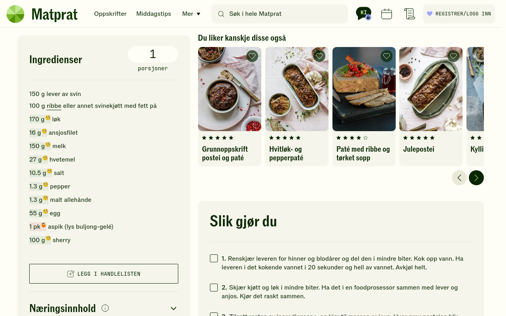
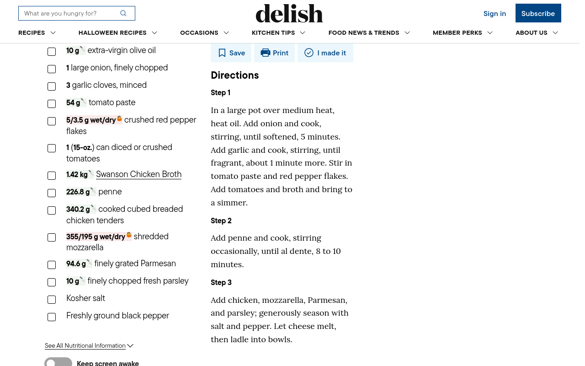

# GramGuru 🧐

> **⚠️ VIBE-CODED ⚠️**
> Written largely by an AI. Review before you trust it.

Converts recipe units to **grams** — Norwegian (`ss`, `dl`, `kopp`) and imperial
(`cups`, `oz`, `lb`). That's it. That's the whole idea.

`3 ss hvetemel` ➜ `27 g` · `1,5 dl melk` ➜ `150 g` · `6 stk egg` ➜ `330 g`

It also drags imperial units, kicking and screaming, into the metric age:
`8 oz smør` ➜ `226.8 g 🔪`.

## Why grams? 📏

Because the metric system is what happens when a civilization sits down and
says _"let's use powers of ten."_ Meanwhile a "cup" of flour is 120 g, a "cup"
of water is 236 g, and a "cup" of your sanity is gone. 🫠

So: everything becomes grams. Kilograms when it's a lot. Milligrams when it's
homeopathy. Never ounces. Never ever cups. (We convert _from_ them, out of
pity. 🇺🇸)

## What it actually does

- 🔎 Finds units like **ss, ts, dl, cl, ml, l, kopp, glass, skive, stk, pk,
  neve, fedd, bunt, boks** — plus imperial **oz, lb, fl oz, cup, tbsp, tsp,
  gallon, pint, quart**.
- 🧮 Looks up real per-ingredient densities from
  [matprat.no](https://www.matprat.no/) (Norwegian) and
  [USDA FoodData Central](https://fdc.nal.usda.gov/) (English), so
  `3 ss hvetemel` ≠ `3 ss sukker` and `1 cup cheddar` ≠ `1 cup milk`.
- 🧐 Marks every conversion inline with a subtle background tint, a one-time pulse,
  and an emoji badge that matches the tooltip: **🧐** exact · **🔪** imperial · **🤷** unknown.
  (No added underline — we don't fight the page's own styling.)
- 🖱️ Hover (or tap) a mark to see e.g. `27 g (exact) 🧐`.
- 🤷 **Unknown ingredient (volume)?** It never invents a single number: it shows
  **both** estimates inline — `30/18 g wet/dry 🤷` — and the tooltip spells them
  out on two lines (`30 g if wet` / `18 g if dry`). Values ≥ 20 drop decimals.
  Unknown **count** units (`stk`, `pk`, …) are ignored, so news prose like
  "8.657 pakker" is left alone.
- 🔢 Shows a count badge on the toolbar icon.
- 🔌 **Zero network calls.** The density tables are bundled. Your recipes stay
  yours. 🕵️

## Example output

| On the page             | GramGuru                                                      |
| ----------------------- | ------------------------------------------------------------- |
| `3 ss hvetemel`         | `27 g`                                                        |
| `1,5 dl melk`           | `150 g`                                                       |
| `0,5 ts pepper`         | `1.3 g`                                                       |
| `3 stk gulrøtter`       | `270 g`                                                       |
| `1 cup cheddar`         | `100 g`                                                       |
| `2 ss` (unknown)        | `30/18 g wet/dry` 🤷 — tooltip: `30 g if wet` / `18 g if dry` |
| `3 stk` (unknown piece) | _(ignored — too noisy in prose)_                              |
| `8 oz smør`             | `226.8 g (exact) 🔪`                                          |

## Screenshots

On [matprat.no](https://www.matprat.no/) — Norwegian units become grams, right on the page:



On a US recipe — cups and ounces become grams (unknowns fall back to wet/dry):



## Install (development)

1. Firefox ➜ `about:debugging#/runtime/this-firefox` ➜ **Load Temporary Add-on…**
2. Pick `manifest.json` in this folder. Done. 🎉

No build step — the files that ship are the source. Plain JavaScript. 🍦

## Development

No npm, no bundler, no transpiler, no TypeScript. Just Node ≥ 20 and plain ES
modules that run as-is.

```bash
node --test tests/           # unit + (optionally live) recipe tests
node scripts/e2e.js          # REAL end-to-end run in headless Firefox
node scripts/screenshots.js  # AMO listing screenshots -> screenshots/ (1280x800)
node scripts/package.js      # zip the extension into web-ext-artifacts/
node scripts/package.js --beta   # zip a beta-channel build (separate add-on id)
node scripts/build-data.js   # optional: refresh src/data.js from matprat.no
```

The beta build is the same code with a different manifest id (`gramguru-beta@anderss`)
and version, so it registers as its own (unlisted, self-distributed) add-on — no
review wait. Override with `BETA_ADDON_ID`, `BETA_VERSION`, `BETA_UPDATE_URL`.

Because self-distributed add-ons don't auto-update through AMO, beta builds set
`browser_specific_settings.gecko.update_url` to the HTTPS `updates.json` in this
repo. AMO's unlisted download link is developer-only (auth required), so the
signed XPI is committed under `beta/` and served from the repo's raw URL.
`scripts/publish.js --channel unlisted` downloads the signed XPI into `beta/`
and records `{version, update_link}` in `updates.json`; commit + push both to
deliver the update. Firefox keeps using the `update_url` baked into the installed
version, so it must be present from the first install (betas built before it was
added won't auto-update and need one manual reinstall).

`node --test` fetches the real recipe pages and asserts the conversions. Offline?
It falls back to cached fixtures in `tests/fixtures/`. Refresh fixtures with
`GRAMGURU_UPDATE_FIXTURES=1 node --test tests/`.

`node scripts/e2e.js` is the honest test: it launches headless Firefox, installs
the extension as a temporary add-on over WebDriver BiDi (the same mechanism
`about:debugging` uses), and checks the actually-injected marks on the local test
kitchen plus both real recipe sites. Results are printed per site. 🧪

Need Firefox on your PATH (it is, if `firefox --version` works). Real-site
checks need network; the local `devtest/testpage.html` does not.

## Privacy

GramGuru has no analytics, no telemetry, and makes no network requests at
runtime. The ingredient densities ship inside the extension, sourced from
matprat.no. The manifest declares this honestly:
`browser_specific_settings.gecko.data_collection_permissions.required = ["none"]`
(required by AMO for all new extensions). See the source; it's small. 🔍

## License

MIT — see [LICENSE](./LICENSE). Made with 🇳🇴 and a deep distrust of fluid ounces. 🧐
